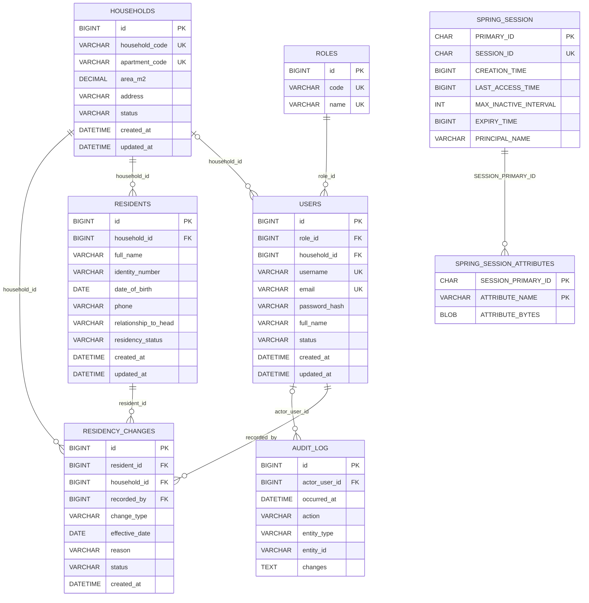

# Cơ sở dữ liệu BlueMoon (migration V1–V4)

MySQL 8.4, schema do Flyway quản lý (`backend/src/main/resources/db/migration/`), Hibernate `ddl-auto=validate`.

## Migration

| Version | File | Nội dung |
|---|---|---|
| V1 | `V1__create_session_tables.sql` | `SPRING_SESSION`, `SPRING_SESSION_ATTRIBUTES` (Spring Session JDBC) |
| V2 | `V2__identity_audit.sql` | `roles`, `users`, `audit_log`; dữ liệu 3 vai trò |
| V3 | `V3__residency.sql` | `households`, `residents`, `residency_changes` |
| V4 | `V4__user_email_household.sql` | `users.email`, `users.household_id` |

## Quy ước
- Khóa chính `id BIGINT AUTO_INCREMENT` (khớp `Long`).
- Thời điểm `DATETIME(6)`, ứng dụng ghi UTC; không có `DEFAULT CURRENT_TIMESTAMP`.
- Trạng thái là `VARCHAR` kèm `CHECK` khi tập giá trị đã cố định; không dùng `ENUM`.
- Bảng `ENGINE = InnoDB`, `utf8mb4`. Cột định danh (`roles.code`, `users.username`, `users.email`, `households.household_code`, `households.apartment_code`) dùng collation `utf8mb4_0900_as_ci`: không phân biệt hoa/thường, phân biệt dấu.
- Khóa ngoại không khai báo `ON DELETE`, nên mặc định `RESTRICT`; ngoại lệ duy nhất là `SPRING_SESSION_ATTRIBUTES` (`CASCADE`).

## ERD

## Quan hệ

| Khóa ngoại | Từ (nhiều) | Đến (một) | Bắt buộc | Ý nghĩa |
|---|---|---|---|---|
| `fk_users_role` | `users.role_id` | `roles.id` | Có | Vai trò của tài khoản |
| `fk_users_household` | `users.household_id` | `households.id` | Không | Hộ của tài khoản cư dân; NULL với nhân sự |
| `fk_residents_household` | `residents.household_id` | `households.id` | Có | Hộ của nhân khẩu |
| `fk_rc_resident` | `residency_changes.resident_id` | `residents.id` | Có | Nhân khẩu có biến động |
| `fk_rc_household` | `residency_changes.household_id` | `households.id` | Có | Hộ tại thời điểm biến động |
| `fk_rc_user` | `residency_changes.recorded_by` | `users.id` | Có | Người ghi nhận biến động |
| `fk_audit_actor` | `audit_log.actor_user_id` | `users.id` | Không | Người thực hiện; NULL cho hành động bootstrap |
| `SPRING_SESSION_ATTRIBUTES_FK` | `SPRING_SESSION_ATTRIBUTES.SESSION_PRIMARY_ID` | `SPRING_SESSION.PRIMARY_ID` | Có | Thuộc tính của phiên (`ON DELETE CASCADE`) |

`SPRING_SESSION.PRINCIPAL_NAME` chứa `users.username` (cùng `VARCHAR(100)`); liên kết ở tầng ứng dụng, không có khóa ngoại.

## Bảng

### roles
| Cột | Kiểu | Null | Ràng buộc |
|---|---|---|---|
| id | BIGINT | Không | PK |
| code | VARCHAR(50) | Không | UNIQUE `uq_roles_code` |
| name | VARCHAR(100) | Không | UNIQUE `uq_roles_name` |

Dữ liệu: `ADMIN` "Ban quản trị", `ACCOUNTANT` "Kế toán", `RESIDENT` "Cư dân".

### users
| Cột | Kiểu | Null | Ràng buộc |
|---|---|---|---|
| id | BIGINT | Không | PK |
| role_id | BIGINT | Không | FK → roles |
| username | VARCHAR(100) | Không | UNIQUE `uq_users_username` |
| password_hash | VARCHAR(255) | Không | |
| full_name | VARCHAR(150) | Không | |
| status | VARCHAR(20) | Không | Mặc định `ACTIVE`; CHECK `ACTIVE`, `INACTIVE` |
| created_at, updated_at | DATETIME(6) | Không | |
| email | VARCHAR(255) | Có | UNIQUE `uq_users_email` (V4) |
| household_id | BIGINT | Có | FK → households; index `idx_users_household` (V4) |

### audit_log
| Cột | Kiểu | Null | Ràng buộc |
|---|---|---|---|
| id | BIGINT | Không | PK |
| occurred_at | DATETIME(6) | Không | |
| actor_user_id | BIGINT | Có | FK → users |
| action | VARCHAR(100) | Không | |
| entity_type | VARCHAR(100) | Không | |
| entity_id | VARCHAR(100) | Có | |
| changes | TEXT | Có | Nội dung thay đổi đã mask PII |

Index: `idx_audit_entity (entity_type, entity_id, occurred_at)`, `idx_audit_actor (actor_user_id, occurred_at)`.

### households
| Cột | Kiểu | Null | Ràng buộc |
|---|---|---|---|
| id | BIGINT | Không | PK |
| household_code | VARCHAR(50) | Không | UNIQUE `uq_households_code` |
| apartment_code | VARCHAR(50) | Không | UNIQUE `uq_households_apartment` |
| area_m2 | DECIMAL(10,2) | Không | CHECK `area_m2 > 0` |
| address | VARCHAR(255) | Có | |
| status | VARCHAR(20) | Không | Mặc định `ACTIVE`; CHECK `ACTIVE`, `INACTIVE` |
| created_at, updated_at | DATETIME(6) | Không | |

### residents
| Cột | Kiểu | Null | Ràng buộc |
|---|---|---|---|
| id | BIGINT | Không | PK |
| household_id | BIGINT | Không | FK → households |
| full_name | VARCHAR(150) | Không | |
| identity_number | VARCHAR(50) | Có | Không UNIQUE; PII |
| date_of_birth | DATE | Có | |
| phone | VARCHAR(30) | Có | PII |
| relationship_to_head | VARCHAR(100) | Có | |
| residency_status | VARCHAR(30) | Không | Không mặc định, không CHECK |
| created_at, updated_at | DATETIME(6) | Không | |

Index: `idx_residents_household (household_id, residency_status)`, `idx_residents_name (full_name)`, `idx_residents_identity (identity_number)`.

### residency_changes
| Cột | Kiểu | Null | Ràng buộc |
|---|---|---|---|
| id | BIGINT | Không | PK |
| resident_id | BIGINT | Không | FK → residents |
| household_id | BIGINT | Không | FK → households |
| change_type | VARCHAR(30) | Không | Không CHECK |
| effective_date | DATE | Không | |
| reason | VARCHAR(255) | Có | |
| status | VARCHAR(20) | Không | Mặc định `PENDING`; CHECK `PENDING`, `APPROVED`, `REJECTED` |
| recorded_by | BIGINT | Không | FK → users |
| created_at | DATETIME(6) | Không | |

Index: `idx_rc_resident_date (resident_id, effective_date)`, `idx_rc_household (household_id)`.

### SPRING_SESSION
| Cột | Kiểu | Null | Ràng buộc |
|---|---|---|---|
| PRIMARY_ID | CHAR(36) | Không | PK |
| SESSION_ID | CHAR(36) | Không | UNIQUE `SPRING_SESSION_IX1` |
| CREATION_TIME | BIGINT | Không | |
| LAST_ACCESS_TIME | BIGINT | Không | |
| MAX_INACTIVE_INTERVAL | INT | Không | |
| EXPIRY_TIME | BIGINT | Không | Index `SPRING_SESSION_IX2` |
| PRINCIPAL_NAME | VARCHAR(100) | Có | Index `SPRING_SESSION_IX3` |

### SPRING_SESSION_ATTRIBUTES
| Cột | Kiểu | Null | Ràng buộc |
|---|---|---|---|
| SESSION_PRIMARY_ID | CHAR(36) | Không | PK (cùng `ATTRIBUTE_NAME`); FK → SPRING_SESSION, `ON DELETE CASCADE` |
| ATTRIBUTE_NAME | VARCHAR(200) | Không | PK |
| ATTRIBUTE_BYTES | BLOB | Không | |

## Quy tắc do tầng service đảm bảo
- Tài khoản có `role_id` là `RESIDENT` phải có `household_id`; nhân sự để NULL. Quyền truy cập theo hộ lấy từ `users.household_id` ở server.
- Cấp tài khoản mới bắt buộc `email`.
- `audit_log.actor_user_id` chỉ NULL với hành động bootstrap; ghi audit cùng transaction với thay đổi dữ liệu.
- `residents.identity_number` kiểm tra trùng trong nhóm nhân khẩu đang cư trú; thông báo lỗi không chứa số giấy tờ.
- Chuyển đi: đổi `residency_status` và thêm bản ghi `residency_changes`; danh sách cư trú hiện tại lọc theo `residency_status`.
- Giá trị hợp lệ của `residency_status` và `change_type` do service kiểm tra.

## Chưa có trong schema
Phí, đơn giá, kỳ thu, hóa đơn, thu tiền (migration V5).
