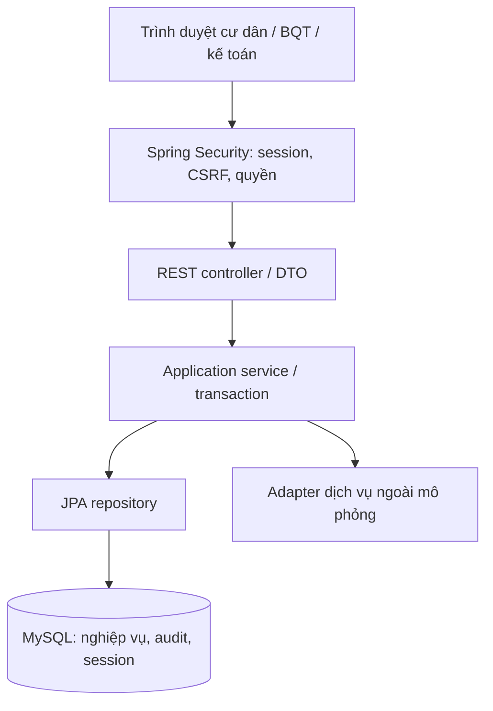

# Kiến trúc và quy ước

## Tổng thể

Sơ đồ là kiến trúc đích v1; skeleton mới có config, session, health và systeminfo. Repository/bảng nghiệp vụ chỉ tạo trong task có AC đã chốt.

## Luồng request
Request → request ID → CORS/security/CSRF → controller validate DTO → service kiểm tra quyền đối tượng và quy tắc → repository trong transaction → DB → response DTO.
HTTP GET metadata mẫu bỏ qua DB; controller không cần repository giả. Filter mặc định được Spring đăng ký; request ID được trả qua header, không chứa dữ liệu cá nhân.
Các write có audit phải lưu thay đổi và audit thành công trong cùng transaction; nếu rollback không có bản ghi audit thành công giả.

## Module đích
`identity` (account/role/session), `residency` (hộ/nhân khẩu/khai báo), `billing` (đơn giá/kỳ thu/hóa đơn), `payment` (thu tiền/công nợ), `reporting` (Excel và gói chia sẻ đã duyệt).
Mỗi module chỉ tạo `api`, `application`, `persistence` và `domain` nếu có quy tắc domain riêng; không sinh hàng loạt interface rỗng.
`config` cho cấu hình, `common/error`, `common/web` và `common/audit` cho cơ chế chung thật sự dùng chung; không đưa nghiệp vụ vào common.

## Quy ước
- Package lowercase; class PascalCase; method/field camelCase; SQL snake_case (trừ bảng hạ tầng SPRING_SESSION theo thư viện).
- API `/api/v1`, danh từ số nhiều, JSON camelCase; URI của từng module phải chốt bằng hợp đồng API trước frontend.
- Request/response tách entity; danh sách có pagination, giới hạn page size đề xuất 100; không fetch toàn bộ 10k để lọc trong Java.
- Constructor injection. Entity không Lombok @Data. Lazy relation; open-in-view=false; xử lý N+1 bằng query/projection khi cần.
- `Instant` UTC cho audit, `LocalDate` cho ngày nghiệp vụ, `YearMonth` cho kỳ thu; chuyển múi giờ nghiệp vụ Asia/Ho_Chi_Minh khi báo cáo.
- BigDecimal; snapshot diện tích/đơn giá vào hóa đơn để thay giá không viết lại lịch sử. Chốt rounding trước triển khai.
- Unique key theo kỳ/hộ/loại phí và idempotency key giao dịch là đề xuất cần xác định đúng nghiệp vụ; không thay khóa DB bằng kiểm tra exists đơn thuần.

## Audit
`common/audit/AuditService.record(...)` ghi bảng `audit_log` (V2) và bắt buộc chạy trong transaction của thay đổi dữ liệu (`MANDATORY`): rollback thì audit cũng rollback; caller không bắt exception quanh lời gọi. `AuditLog` bất biến, repository chỉ có `save`. Thời điểm lấy từ bean `Clock` (UTC). Từ chối khóa PII thô trong `changes`; caller chỉ được đưa trường đã cho phép (D12). Xem `identity/application/RoleService` làm mẫu (chưa có kiểm tra quyền, S01 thay hoặc xóa).

## Auth
Session lưu MySQL, cookie HttpOnly/SameSite=Lax; Secure khi có HTTPS. CSRF áp dụng cho write; frontend phải nhận token qua endpoint bootstrap được xây trong identity rồi gửi `X-CSRF-TOKEN` cùng credentials. Endpoint này chưa tồn tại trong skeleton.
Session fixation protection khi login; hủy phiên khi đổi mật khẩu/khóa account. Phải kiểm tra trạng thái account để request mới không dùng quyền cũ; kiểm thử nhiều phiên và cookie cũ. Không hứa hủy một request đã bắt đầu trước khi khóa.
Không thêm endpoint public bằng wildcard `/api/**`. Cơ quan chỉ lấy gói báo cáo đã duyệt với trường đã cho phép, không đọc bảng thô.

## Error / logging
ProblemDetail JSON: type/title/status/detail phù hợp. 400 validation, 401 chưa login, 403 sai quyền, 404 không tìm thấy, 409 xung đột phiên bản/đã tạo, 500 lỗi nội bộ. Hiện skeleton đã có security 401/403 và handler cơ bản; bổ sung handler 400/409 theo module và test, không bắt mọi lỗi thành 500.
Log kỹ thuật dùng SLF4J và requestId; không log body/PII/secret. Audit nghiệp vụ là bảng riêng, gồm actor, action, entity, thời điểm và thay đổi được phép ghi; mask dữ liệu nhạy cảm.

## NFR
NFR-004 đã có ngưỡng ≤3 giây với 10.000 hồ sơ cho tra cứu cư dân/danh sách khoản thu. Cần ghi máy, query, phân trang, số lần đo, warm-up và tải đồng thời. Đề xuất chạy 30 lần sau warm-up, công bố p95/max; cách chấp nhận cuối phải được duyệt, không tự đổi yêu cầu thành p95.
NFR-008 backup/restore và NFR-010 retention phải có task/bằng chứng; Docker volume không phải backup.
