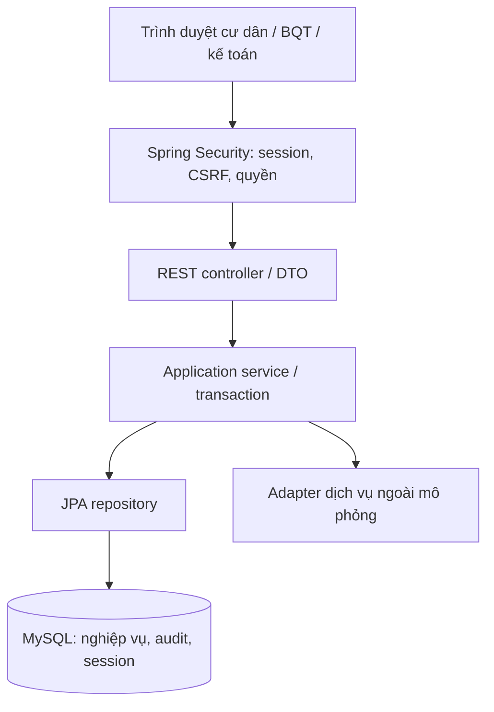

# Kiến trúc và quy ước

## Tổng thể

Sơ đồ là kiến trúc đích v1; hiện có config, session, health, systeminfo, audit và đăng nhập/session/khóa tài khoản của `identity` (S01). Repository/bảng nghiệp vụ khác chỉ tạo trong task có AC đã chốt.

## Luồng request
Request → request ID → CORS/security/CSRF → controller validate DTO → service kiểm tra quyền đối tượng và quy tắc → repository trong transaction → DB → response DTO.
HTTP GET metadata mẫu bỏ qua DB; controller không cần repository giả. Filter mặc định được Spring đăng ký; request ID được trả qua header, không chứa dữ liệu cá nhân.
Các write có audit phải lưu thay đổi và audit thành công trong cùng transaction; nếu rollback không có bản ghi audit thành công giả.

## Module đích
`identity` (account/role/session), `residency` (hộ/nhân khẩu/khai báo), `billing` (đơn giá/kỳ thu/hóa đơn), `payment` (thu tiền/công nợ), `reporting` (Excel và gói chia sẻ đã duyệt).
Mỗi module chỉ tạo `api`, `application`, `persistence` và `domain` nếu có quy tắc domain riêng; không sinh hàng loạt interface rỗng.
`config` cho cấu hình, `common/error`, `common/web` và `common/audit` cho cơ chế chung thật sự dùng chung; không đưa nghiệp vụ vào common.

## Quy ước
- Package lowercase; class PascalCase; method/field camelCase; SQL snake_case (trừ bảng hạ tầng SPRING_SESSION theo thư viện).
- API `/api/v1`, danh từ số nhiều, JSON camelCase; URI của từng module phải chốt bằng hợp đồng API trước frontend.
- Request/response tách entity; danh sách có pagination, giới hạn page size đề xuất 100; không fetch toàn bộ 10k để lọc trong Java.
- Constructor injection. Entity không Lombok @Data. Lazy relation; open-in-view=false; xử lý N+1 bằng query/projection khi cần.
- `Instant` UTC cho audit, `LocalDate` cho ngày nghiệp vụ, `YearMonth` cho kỳ thu; chuyển múi giờ nghiệp vụ Asia/Ho_Chi_Minh khi báo cáo.
- BigDecimal; snapshot diện tích/đơn giá vào hóa đơn để thay giá không viết lại lịch sử. Chốt rounding trước triển khai.
- Unique key theo kỳ/hộ/loại phí và idempotency key giao dịch là đề xuất cần xác định đúng nghiệp vụ; không thay khóa DB bằng kiểm tra exists đơn thuần.

## Audit
`common/audit/AuditService.record(...)` ghi bảng `audit_log` (V2) và bắt buộc chạy trong transaction của thay đổi dữ liệu (`MANDATORY`): rollback thì audit cũng rollback; caller không bắt exception quanh lời gọi. `AuditLog` bất biến, repository chỉ có `save`. Thời điểm lấy từ bean `Clock` (UTC). Từ chối khóa PII thô trong `changes`; caller chỉ được đưa trường đã cho phép (D12). Xem `identity/application/RoleService` làm mẫu (chưa có kiểm tra quyền, không gắn controller; giữ nguyên theo quyết định S01 G1). `recordBootstrap` là đường riêng cho lệnh tạo BQT đầu tiên: actor NULL, action cố định `BOOTSTRAP_ADMIN`. Đăng nhập ghi `LOGIN_SUCCESS`, `LOGIN_FAILED`, `ACCOUNT_LOCKED` cùng transaction (D18).

## Auth
Session lưu MySQL, cookie HttpOnly/SameSite=Lax; Secure khi có HTTPS. CSRF áp dụng cho write; frontend nhận token qua `GET /api/v1/auth/csrf` rồi gửi `X-CSRF-TOKEN` cùng credentials, và lấy token mới sau login và logout (token và session ID đổi). Các endpoint `/api/v1/auth/{csrf,login,logout,me}` đã có (S01), cùng `/api/v1/auth/change-password` (S03); chỉ `csrf` và `login` công khai. `POST /api/v1/accounts` (S02) chỉ ADMIN, CSRF mặc định (thiếu hoặc sai CSRF trả 403 trước 401); mọi đường khác `denyAll`.
Cấp account (S02, D14, D19): ADMIN tạo ADMIN/ACCOUNTANT/RESIDENT; mật khẩu tạm do server sinh, chỉ nằm trong email mô phỏng (`MockEmailService`, bảng `mock_emails`, `MANDATORY`, không có API đọc), cùng transaction với tạo user và audit `ACCOUNT_CREATED`; account mới có `must_change_password = TRUE` (cờ lưu trong session, `/auth/login` và `/auth/me` trả `mustChangePassword`). `MustChangePasswordFilter` chạy trước `AuthorizationFilter` và chặn mọi request ngoài danh sách cho phép (`/auth/me`, `/auth/csrf`, `/auth/login`, `/auth/logout`, `/auth/change-password`, health, system/info) bằng 403 `code: PASSWORD_CHANGE_REQUIRED` (fail-closed). Bootstrap BQT đầu tiên chạy bằng profile `bootstrap` qua `System.console()` (D16), tự vô hiệu khi đã có ADMIN.
Login đổi session ID (session fixation) và lưu principal là `users.username` đọc từ DB. Mọi lỗi đăng nhập trả cùng một body 401. Khóa theo account (D17, D18) và thời điểm khóa lưu `Instant` UTC; `ADMIN` không bị khóa. Quyền và `status` hiện được nạp lúc login và lưu trong session.
Đổi mật khẩu S03: `POST /api/v1/auth/change-password` yêu cầu session và CSRF, kiểm tra mật khẩu cũ, quy tắc mật khẩu mới và trạng thái khóa; thành công xóa cờ, che nội dung email mô phỏng khi cần, ghi audit và dùng `DELETE ... WHERE PRINCIPAL_NAME` trong transaction để xóa mọi dòng session của account, kể cả session đang dùng; sau commit, `SecurityContextLogoutHandler` dọn SecurityContext và cookie của request hiện tại. Client lấy CSRF mới và đăng nhập lại.

Lỗi còn lại: đăng nhập bằng mật khẩu cũ ngay trước lúc đổi có thể tạo session sau lệnh xóa; cần phiên bản mật khẩu hoặc cột mới, chưa làm. S04 kiểm tra lại trạng thái account mỗi request; không hứa hủy một request đã bắt đầu trước khi khóa.
Không thêm endpoint public bằng wildcard `/api/**`. S12 không tạo role/account cho cơ quan: BQT tiếp nhận yêu cầu và kiểm tra giấy phép ngoài hệ thống; ADMIN tạo gói theo phạm vi hộ, xem trước và ghi nhận tham chiếu yêu cầu/giấy phép; một ADMIN khác phải duyệt trước khi tải. BQT tải và bàn giao gói ngoài hệ thống. Các endpoint `/api/v1/agency-data-packages` và `/{id}/preview`, `/approve`, `/reject`, `/revoke`, `/content.xlsx`, `/handoff` chỉ phục vụ ADMIN theo phân quyền server; response không mở quyền truy vấn DB thô. Gói hết hạn tải tại thời điểm sớm hơn giữa duyệt + 7 ngày và tạo + 30 ngày; cleanup chạy mỗi 60 giây, chặn tải đúng hạn. Metadata/audit tối thiểu giữ 5 năm theo mục tiêu NFR-010, không tuyên bố đây là yêu cầu pháp luật.

## Error / logging
ProblemDetail JSON: type/title/status/detail phù hợp. 400 validation, 401 chưa login, 403 sai quyền, 404 không tìm thấy, 409 xung đột phiên bản/đã tạo, 500 lỗi nội bộ. Hiện skeleton đã có security 401/403 và handler cơ bản; bổ sung handler 400/409 theo module và test, không bắt mọi lỗi thành 500. S02 thêm 400 (`HOUSEHOLD_REQUIRED`, `HOUSEHOLD_INVALID`, `HOUSEHOLD_NOT_ALLOWED`) và 409 (`EMAIL_ALREADY_USED`, `USERNAME_ALREADY_USED`, `ACCOUNT_CONFLICT`) qua `BadRequestException`/`ConflictException` có `code`; `detail` là chuỗi cố định, không chứa giá trị người dùng. Logger Hibernate `org.hibernate.orm.jdbc.error` đặt `OFF` để lỗi trùng khóa không in email (mất log lỗi SQL của Hibernate; bind TRACE vẫn lộ, không bật).
Log kỹ thuật dùng SLF4J và requestId; không log body/PII/secret. Audit nghiệp vụ là bảng riêng, gồm actor, action, entity, thời điểm và thay đổi được phép ghi; mask dữ liệu nhạy cảm.

## NFR
NFR-004 đã có ngưỡng ≤3 giây với 10.000 hồ sơ cho tra cứu cư dân/danh sách khoản thu. Cần ghi máy, query, phân trang, số lần đo, warm-up và tải đồng thời. Đề xuất chạy 30 lần sau warm-up, công bố p95/max; cách chấp nhận cuối phải được duyệt, không tự đổi yêu cầu thành p95.
NFR-008 backup/restore và NFR-010 retention phải có task/bằng chứng; Docker volume không phải backup.
