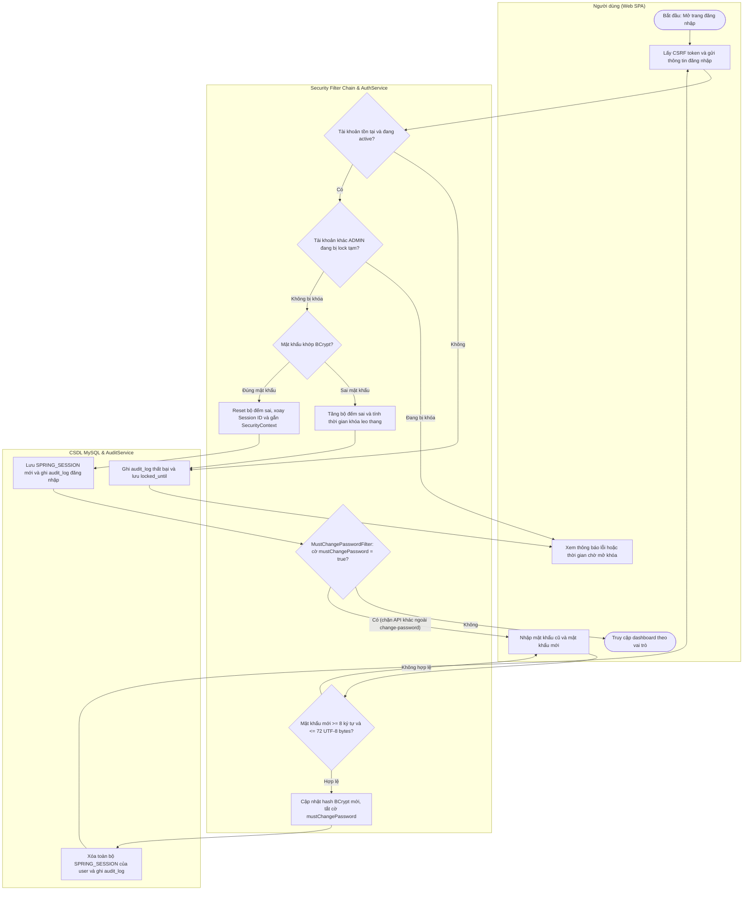
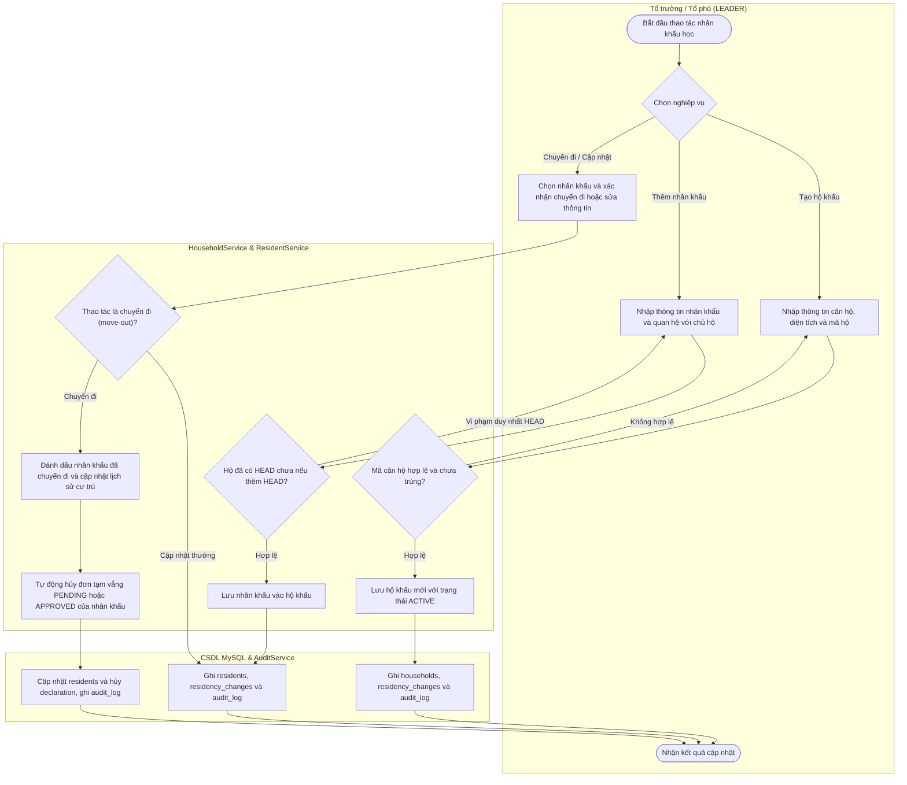
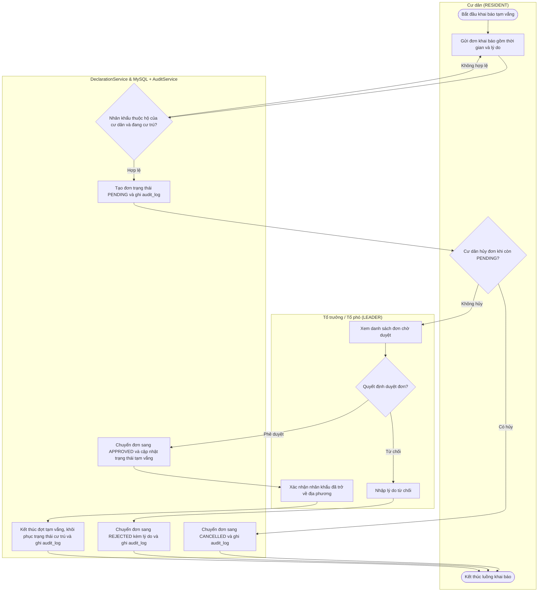
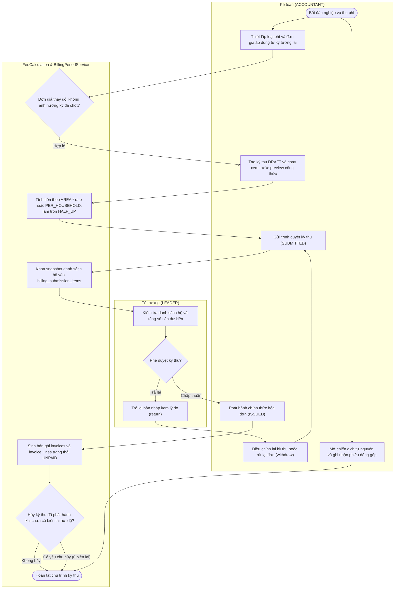
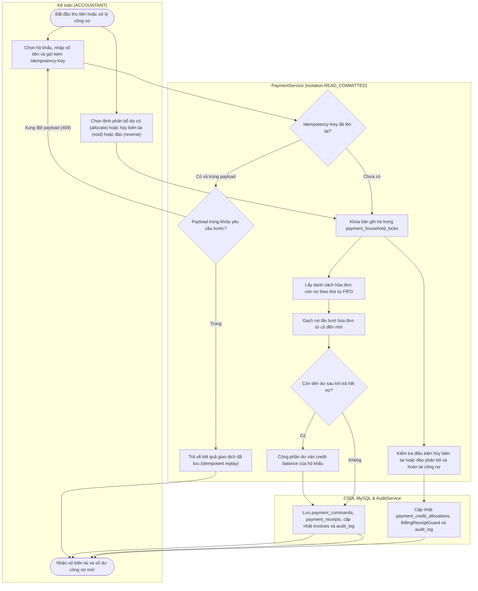
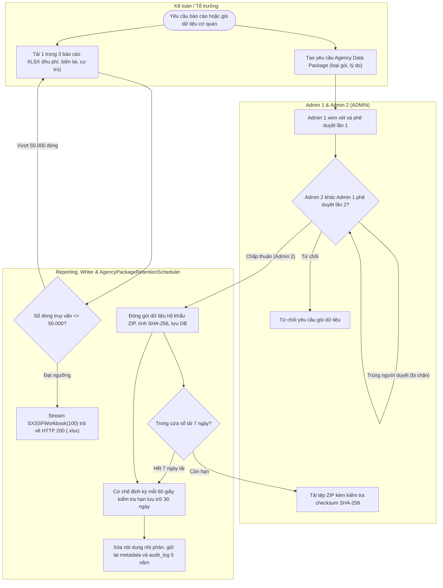
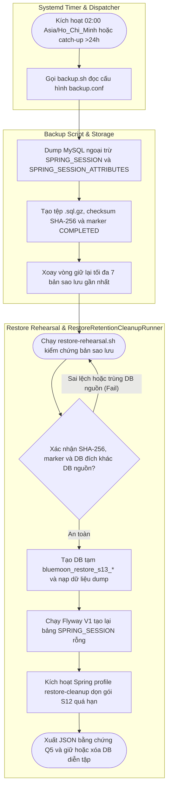

# Sơ đồ Hoạt động UML (Activity Diagrams) — BlueMoon Complex (Sprint 1)

Tài liệu đặc tả các luồng nghiệp vụ trọng tâm của hệ thống **BlueMoon Complex (SE_10)** dưới dạng **UML Activity Diagram** (Mermaid `flowchart TD` với phân làn trách nhiệm / swimlanes), bám sát `docs/BRD.md`, `docs/SRS.md`, `docs/DECISIONS.md` (`D01`–`D29`) và `docs/BACKUP_RESTORE.md`.

## Danh mục sơ đồ

| Mã | Tên sơ đồ | Phân hệ / Tham chiếu | Tác nhân tham gia |
| :--- | :--- | :--- | :--- |
| **AD-01** | Xác thực, chống brute-force và đổi mật khẩu bắt buộc | `identity` (`D17`–`D19`, `D22`–`D23`) | Người dùng, Security Filter Chain, AuthService, CSDL |
| **AD-02** | Quản lý hộ khẩu, nhân khẩu và ghi nhận chuyển đi | `residency` (`D20`–`D21`, `D24`) | Tổ trưởng, ResidencyService, CSDL |
| **AD-03** | Khai báo tạm vắng, phê duyệt và xác nhận trở về | `residency` (`D24`) | Cư dân, Tổ trưởng, DeclarationService, CSDL |
| **AD-04** | Thiết lập đơn giá, lập kỳ thu và đóng góp tự nguyện | `billing` (`D25`–`D26`) | Kế toán, Tổ trưởng, BillingService, CSDL |
| **AD-05** | Thu tiền mặt tại quầy, phân bổ FIFO và hủy/đảo biên lai | `payment` (`D27`–`D28`) | Kế toán, PaymentService, CSDL |
| **AD-06** | Xuất báo cáo XLSX và chu trình phê duyệt 2 Admin (S12) | `reporting` (`D13`, `D29`) | Kế toán, Tổ trưởng, Admin 1, Admin 2, Scheduler |
| **AD-07** | Sao lưu định kỳ và diễn tập phục hồi thảm họa (S13) | `ops/backup` (`S13 Q1`–`Q5`) | Systemd Timer, Ops Script, MySQL, Cleanup Runner |

---

## AD-01: Xác thực, chống brute-force và đổi mật khẩu bắt buộc

Mô tả luồng từ lúc người dùng đăng nhập (`POST /api/v1/auth/login`), cơ chế khóa leo thang (`1/5/10/15/30/60/+60` phút, miễn trừ `ADMIN`), bắt buộc đổi mật khẩu lần đầu qua `MustChangePasswordFilter`, đến thu hồi toàn bộ `SPRING_SESSION` khi đổi mật khẩu (`D17`–`D19`, `D23`).

---

## AD-02: Quản lý hộ khẩu, nhân khẩu và ghi nhận chuyển đi

Mô tả quy trình tạo/cập nhật hộ khẩu, thêm nhân khẩu (đảm bảo duy nhất 1 chủ hộ `HEAD`), xử lý nhân khẩu chuyển đi (`move-out`) và tự động hủy các đơn tạm vắng đang chờ hoặc đang hiệu lực liên quan (`D20`, `D21`, `D24`).

---

## AD-03: Khai báo tạm vắng, phê duyệt và xác nhận trở về

Mô tả vòng đời đơn khai báo tạm vắng của cư dân, quyền tự hủy khi đang chờ duyệt (`PENDING`), quyền duyệt/từ chối của Tổ trưởng (`LEADER`), và nghiệp vụ xác nhận nhân khẩu đã trở về (`POST /api/v1/residents/{id}/return`) (`D24`).

---

## AD-04: Thiết lập đơn giá, lập kỳ thu và đóng góp tự nguyện

Mô tả luồng tạo/cập nhật đơn giá (`AREA` hoặc `PER_HOUSEHOLD`, làm tròn `HALF_UP`, chỉ chỉnh tương lai), quy trình `DRAFT -> SUBMITTED -> APPROVED/RETURNED -> ISSUED` và ghi nhận chiến dịch đóng góp tự nguyện (`D25`, `D26`).

---

## AD-05: Thu tiền mặt tại quầy, phân bổ FIFO và hủy/đảo biên lai

Mô tả giao dịch `READ_COMMITTED` có kiểm soát trùng lặp bằng `Idempotency-Key` (`actor`, `key`, `payload`), khóa hàng hộ khẩu `lockHousehold`, tự động phân bổ tiền thu theo FIFO vào hóa đơn cũ nhất trước, đẩy phần dư thành số dư có hộ (`credit balance`), hoặc hủy biên lai / đảo phân bổ (`D27`, `D28`).

---

## AD-06: Xuất báo cáo XLSX và chu trình phê duyệt 2 Admin (S12)

Mô tả 2 luồng xuất dữ liệu: (a) 3 báo cáo XLSX cho Kế toán/Tổ trưởng với giới hạn `50.000` dòng (`SXSSFWorkbook`), và (b) chu trình S12 tạo gói dữ liệu cơ quan yêu cầu 2 Admin độc lập phê duyệt, kiểm soát tải tối đa 7 ngày và bộ dọn dẹp 60 giây xóa nội dung sau 30 ngày nhưng giữ metadata/audit 5 năm (`D13`, `D29`).

---

## AD-07: Sao lưu định kỳ và diễn tập phục hồi thảm họa (S13)

Mô tả quy trình sao lưu lúc 02:00 `Asia/Ho_Chi_Minh` (`backup-dispatch.sh` + `backup.sh`, loại trừ `SPRING_SESSION*`, giữ 7 bản, tạo SHA-256 + `COMPLETED`) và quy trình diễn tập phục hồi sang CSDL tách biệt `bluemoon_restore_s13_*` kèm dọn dẹp gói quá hạn bằng profile `restore-cleanup` (`docs/BACKUP_RESTORE.md`).

