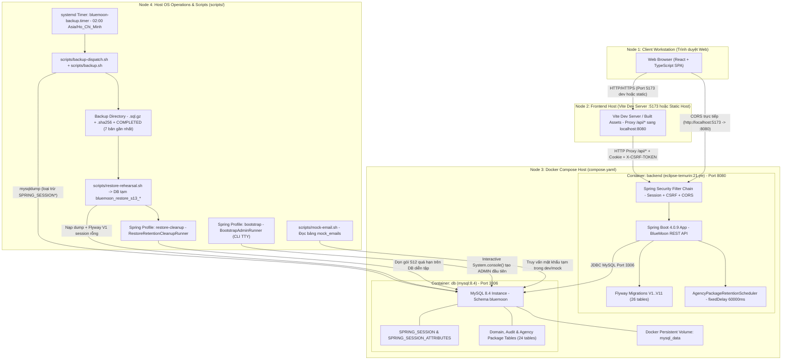
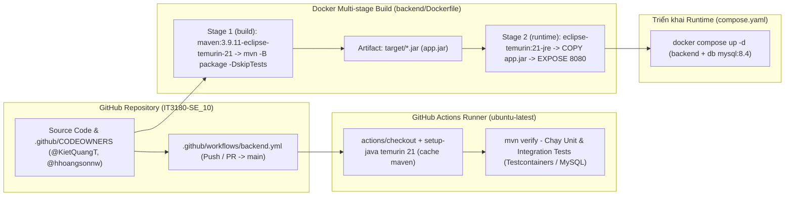

# Sơ đồ Triển khai UML (Deployment Diagrams) — BlueMoon Complex (Sprint 1)

Tài liệu đặc tả kiến trúc triển khai vật lý/container, luồng đóng gói Docker multi-stage, quy trình CI trên GitHub Actions và hạ tầng vận hành sao lưu – phục hồi của **BlueMoon Complex (SE_10)**, đối chiếu trực tiếp với nhánh `main` (`compose.yaml`, `backend/Dockerfile`, `backend/pom.xml`, `backend/src/main/resources/application.yml`, `frontend/vite.config.ts`, `.github/workflows/backend.yml`, `scripts/`).

---

## DD-01: Kiến trúc Triển khai Runtime (Local / Staging Host & Docker Compose)

Sơ đồ dưới đây mô tả các node chạy thực tế trên máy chủ/máy phát triển: trình duyệt người dùng, Vite dev server / Production SPA bundle, Docker Network chứa container `backend` (JDK 21 JRE + Spring Boot `4.0.9`) và `db` (MySQL `8.4`), cùng các tiến trình vận hành phía Host OS (`systemd` timer `02:00 Asia/Ho_Chi_Minh`, bộ script sao lưu/diễn tập phục hồi S13, và profile khởi tạo CLI `BootstrapAdminRunner`).

---

## DD-02: Quy trình Build Multi-stage Docker & CI Pipeline (GitHub Actions)

Sơ đồ mô tả quy trình đóng gói image `backend/Dockerfile` (2 stage trên JDK/JRE 21 của nhánh `main`) và luồng kiểm thử tích hợp tự động `.github/workflows/backend.yml`.

> [!NOTE]
> Phiên bản JDK trong sơ đồ bám sát nhánh `origin/main` hiện tại (`maven:3.9.11-eclipse-temurin-21`, `eclipse-temurin:21-jre`, GitHub Actions `java-version: '21'`). Việc nâng cấp lên JDK 25 LTS (nếu áp dụng) được theo dõi ở bản cập nhật cấu hình riêng.

---

## Đặc tả Hạ tầng, Cổng mạng, Lưu trữ và Ranh giới Bảo mật

| Thành phần / Node | Công nghệ / Image (`main`) | Cổng / Giao thức | Biến môi trường & Lưu trữ chính | Ranh giới bảo mật & Ghi chú vận hành |
| :--- | :--- | :--- | :--- | :--- |
| **Frontend Dev / Build** | React, TypeScript, Vite (`frontend/vite.config.ts`) | `5173` (HTTP dev proxy `/api` -> `8080`) | Nguồn tĩnh SPA, gửi kèm `X-CSRF-TOKEN` và cookie session | Chịu kiểm soát CORS `http://localhost:5173` trên backend |
| **Backend API** | Spring Boot `4.0.9`, `eclipse-temurin:21-jre` | `8080` (HTTP REST `/api/v1/**`) | `SPRING_DATASOURCE_*`, `BLUEMOON_CORS_ALLOWED_ORIGINS` | `CurrentAccountFilter` -> `MustChangePasswordFilter` -> `AuthorizationFilter`; bắt buộc `Idempotency-Key` cho giao dịch thanh toán |
| **Database Server** | `mysql:8.4` (`compose.yaml`) | `3306` (TCP/JDBC) | Volume `mysql_data`, Flyway `V1`–`V11` (26 bảng) | Chỉ mở cho backend trong mạng Docker Compose và các tác vụ Ops có quyền trên host |
| **Scheduled Retention** | `AgencyPackageRetentionScheduler` (in-process) | Trong tiến trình JVM (`60.000 ms`) | Bảng `agency_data_packages`, `agency_data_package_contents` | Xóa nội dung gói S12 sau 30 ngày, đóng link tải sau 7 ngày, giữ metadata & `audit_log` 5 năm |
| **Backup Scheduler** | `bluemoon-backup.timer` + `backup-dispatch.sh` + `backup.sh` | Host `systemd` (02:00 `Asia/Ho_Chi_Minh`) | Tệp `.sql.gz`, `.sha256`, `COMPLETED` (giữ 7 bản) | Loại trừ `SPRING_SESSION*` để tránh rò rỉ phiên đăng nhập vào bản sao lưu |
| **Restore Rehearsal** | `restore-rehearsal.sh` + profile `restore-cleanup` | Host CLI / MySQL | DB tách biệt `bluemoon_restore_s13_*`, xuất JSON Q5 | Chặn ghi đè lên DB nguồn (`source DB guard`), dựng lại bảng session rỗng từ `V1` |
| **Bootstrap Admin** | `BootstrapAdminRunner` (`@Profile("bootstrap")`) | Host CLI (`System.console()`) | Tương tác trực tiếp bàn phím TTY | Không cấu hình mật khẩu Admin mặc định trong file YAML/mã nguồn (`D16`) |
