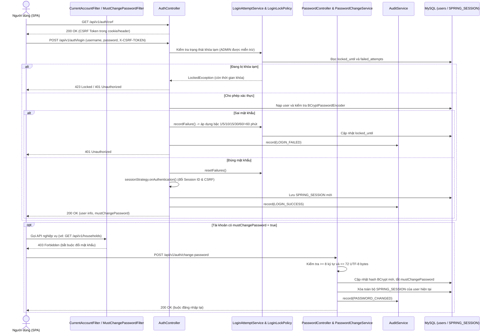
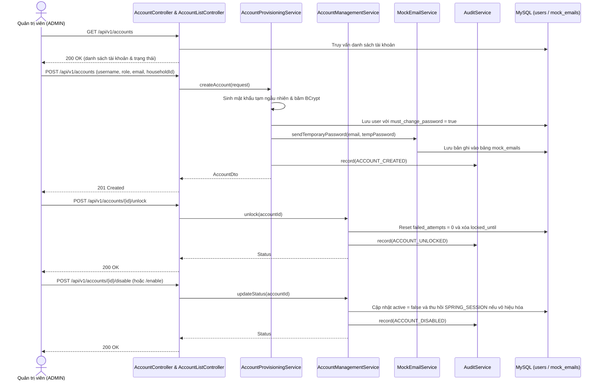
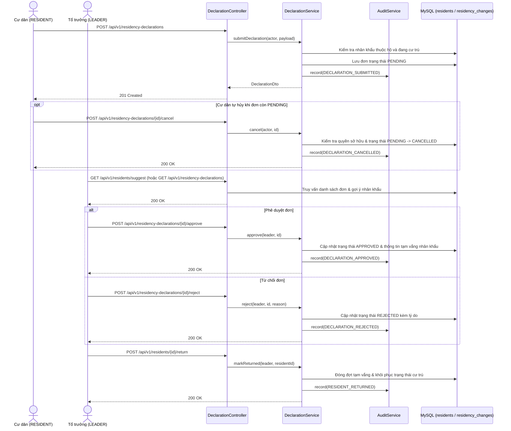
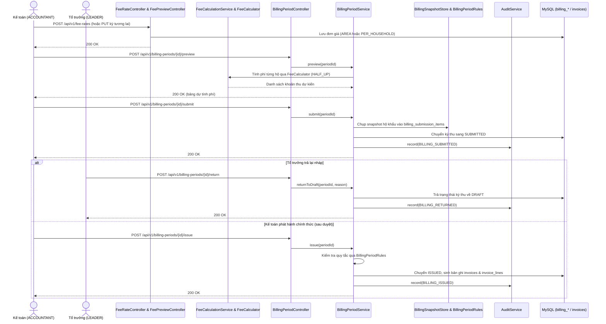
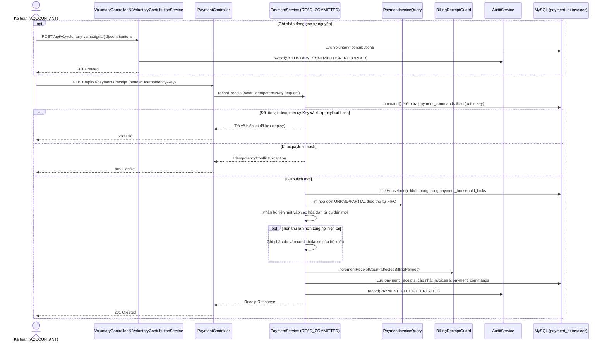
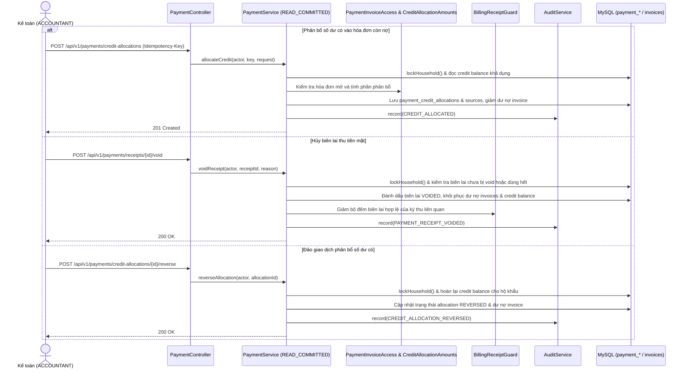
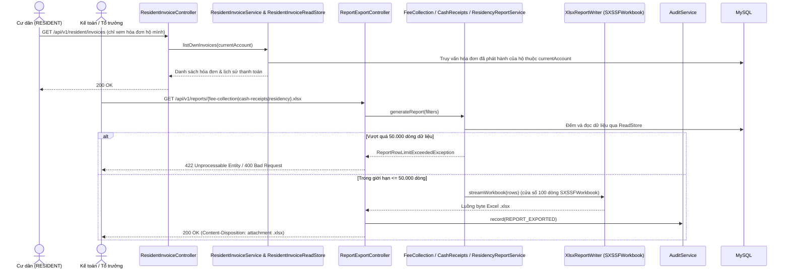
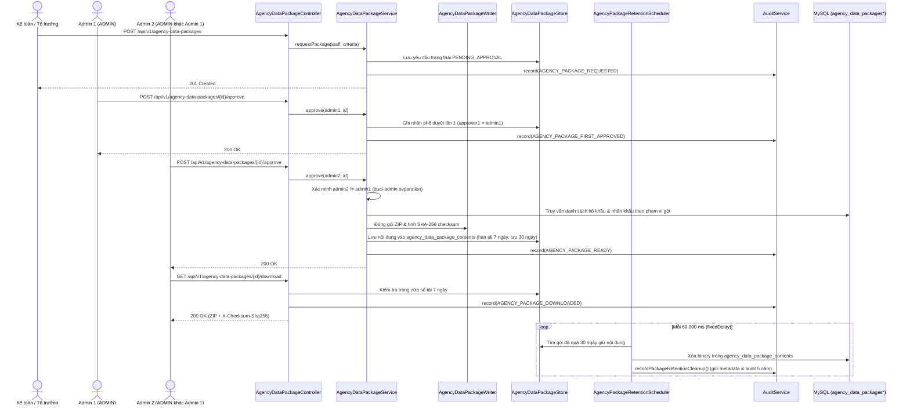

# Sơ đồ Tuần tự UML (Sequence Diagrams) — BlueMoon Complex (Sprint 1)

Tài liệu đặc tả tương tác theo thời gian giữa Client, Spring Security Filter Chain, Controllers, Services, Stores/Repositories và MySQL trong hệ thống **BlueMoon Complex (SE_10)** bằng Mermaid `sequenceDiagram`, đối chiếu trực tiếp với mã nguồn `backend/src/main/java/vn/edu/se10/bluemoon/`.

## Danh mục sơ đồ

| Mã | Kịch bản tương tác | Thành phần chính tham gia |
| :--- | :--- | :--- |
| **SD-01** | CSRF, Đăng nhập, Chống brute-force & Đổi mật khẩu lần đầu | `AuthController`, `LoginAttemptService`, `MustChangePasswordFilter`, `PasswordController`, `AuditService` |
| **SD-02** | Quản lý tài khoản, Cấp mật khẩu tạm & Mở khóa bởi Admin | `AccountController`, `AccountProvisioningService`, `AccountManagementService`, `MockEmailService` |
| **SD-03** | Khai báo tạm vắng, Phê duyệt / Từ chối & Xác nhận trở về | `DeclarationController`, `DeclarationService`, `AuditService` |
| **SD-04** | Thiết lập đơn giá, Dự tính phí & Vòng đời kỳ thu | `FeeRateController`, `FeeCalculationService`, `BillingPeriodController`, `BillingPeriodService`, `BillingSnapshotStore` |
| **SD-05** | Đóng góp tự nguyện & Thu tiền mặt tại quầy (Idempotency + FIFO) | `VoluntaryController`, `PaymentController`, `PaymentService`, `PaymentInvoiceQuery`, `BillingReceiptGuard` |
| **SD-06** | Phân bổ số dư có, Hủy biên lai & Đảo phân bổ công nợ | `PaymentController`, `PaymentService`, `PaymentInvoiceAccess`, `ReceiptAmounts`, `CreditAllocationAmounts` |
| **SD-07** | Cư dân tra cứu hóa đơn & Xuất 3 báo cáo XLSX (50.000 dòng) | `ResidentInvoiceController`, `ReportExportController`, `XlsxReportWriter`, `*ReadStore` |
| **SD-08** | Gói dữ liệu cơ quan S12 (Phê duyệt 2 Admin, Tải ZIP & Retention 60s) | `AgencyDataPackageController`, `AgencyDataPackageService`, `AgencyDataPackageWriter`, `AgencyPackageRetentionScheduler` |

---

## SD-01: CSRF, Đăng nhập, Chống brute-force & Đổi mật khẩu lần đầu

---

## SD-02: Quản lý tài khoản, Cấp mật khẩu tạm & Mở khóa bởi Admin

---

## SD-03: Khai báo tạm vắng, Phê duyệt / Từ chối & Xác nhận trở về

---

## SD-04: Thiết lập đơn giá, Dự tính phí & Vòng đời kỳ thu

---

## SD-05: Đóng góp tự nguyện & Thu tiền mặt tại quầy (Idempotency + FIFO)

---

## SD-06: Phân bổ số dư có, Hủy biên lai & Đảo phân bổ công nợ

---

## SD-07: Cư dân tra cứu hóa đơn & Xuất 3 báo cáo XLSX (50.000 dòng)

---

## SD-08: Gói dữ liệu cơ quan S12 (Phê duyệt 2 Admin, Tải ZIP & Retention 60s)

